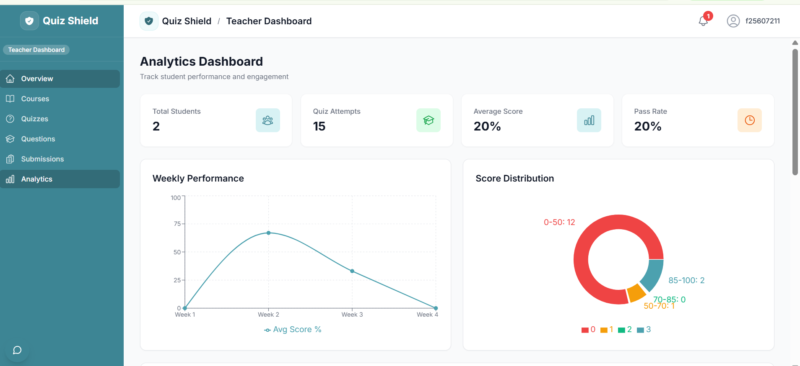
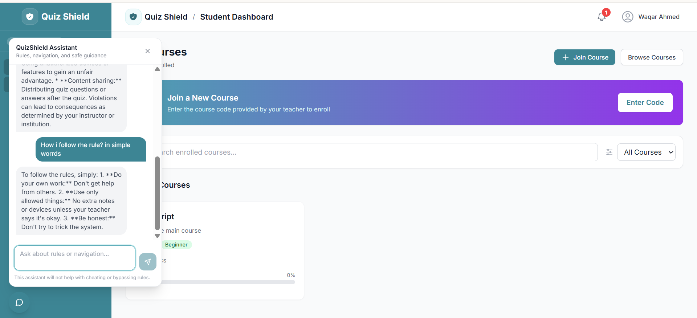
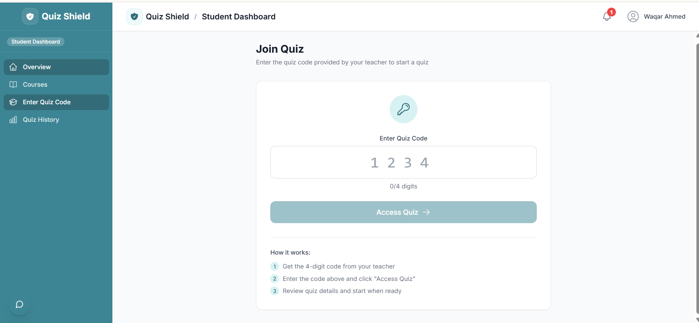

# QuizShield

Current feature status: [administrator implementation and verification](ADMINISTRATION.md). Develop and test on the separate staging projects. Production and GitHub Pages remain unchanged.

> Our ICAT project by **Waqar** — built out of frustration, shipped as a real platform.

---

## The problem that started it all

Durig COVID classes were moved online. So did the exams. Within a week, everyone knew the trick: open a second tab, mute the mic, look busy. Teachers could see us on Zoom but couldn't see what we were actually doing. The "honor system" was doing a lot of heavy lifting it wasn't built for.

I thought: *what if the platform itself was the invigilator?*

That question became QuizShield.

---

## What it does

QuizShield is a full-stack proctored quiz platform where honesty is enforced at the system level, not by someone watching a grid of 30 faces.

- **Email/password sign-in** — all three roles use the existing authentication system. Current account status, role and session version are checked on every protected API request.
- **Administrator dashboard** — account access, course transfers, automation assignments, execution investigation and audit history at `/dashboard/admin`.
- **Live proctoring** — tab switches and focus loss are logged as violations in real time during the quiz.
- **Teacher dashboard** — create courses, build quizzes, review submissions, and see a per-student violation report before you grade.
- **Optional AI question generation** — Gemini can draft questions when a valid backend key is configured. Staging currently reports AI as unavailable; it does not fabricate responses.
- **4-digit access codes** — students join quizzes with a short code, no link-hunting required.

---

## How the login actually works

1. Sign in with email and password. No photo, facial enrolment or camera permission is required.
2. The backend validates credentials and current account status, then issues a session.
3. Every protected request reads the current account and session version. Suspension, role changes, password reset and online logout revoke existing access.
4. The frontend redirects administrators, teachers and students to their own dashboards.

The first administrator is created only through the [operator bootstrap procedure](ADMINISTRATION.md#first-administrator). Public registration never grants administrator access.

---

## Screens

<p align="center">
  <a href="./Teacher-Dashboard.png"></a>
  <a href="./Chatbot.png"></a>
</p>
<p align="center">
  <a href="./Quiz.png"></a>
</p>

---

## Stack

| Layer | Tech |
|-------|------|
| Frontend | React 18 · TypeScript · Vite · Tailwind · Zustand |
| Backend | Node.js · Express · TypeScript · JWT · bcryptjs · helmet · express-rate-limit |
| Services | Supabase (Postgres) · Google Generative AI (Gemini) · Resend · Fastn |

---

## Project layout

```
QuizShield/
├── frontend/   # React app, role-specific dashboards and assessment UI
├── backend/    # Express API, Supabase client, migrations
└── .github/    # CI workflows
```

---

## Run it locally

```bash
# backend
cd backend && npm install && npm run dev

# frontend (new terminal)
cd frontend && npm install && npm run dev
```

**Backend `.env`:**

```env
SUPABASE_URL=
SUPABASE_KEY=
SUPABASE_SERVICE_KEY=
JWT_SECRET=          # 32+ chars
GEMINI_API_KEY=
RESEND_API_KEY=
FRONTEND_URL=http://localhost:3000
PORT=5000
NODE_ENV=development
```

Apply the existing schema and additive migrations through 012 in order. The legacy schema files are retained as history; the application no longer reads or writes biometric descriptors. Do not run the separately gated cleanup under `backend/migrations/review/` automatically.

---

## Validate

Durable assessment scheduling and Fastn workflow setup are documented in [AUTOMATIONS.md](./AUTOMATIONS.md). Run migrations 007 and 008 in order before using the new draft/publication, results-release and verified Google connection controls. Controlled staging live acceptance passed for email, Calendar and Sheets; unrestricted student delivery remains disabled. See [the verification report](./backend/deploy/STAGING-VERIFICATION.md).

```bash
# backend
cd backend && npx tsc --noEmit && npm test

# frontend
cd frontend && npm run lint && npm run build
```

---

## Deploy

- **Frontend** → GitHub Pages (Vite `BASE_URL` keeps asset paths intact)
- **Backend** → Vercel serverless
- **Database** → Supabase

---

## Security

The backend was reviewed by a senior QA engineer — covering atomic submissions, race conditions, JWT lifetime, password hashing, helmet headers, and input validation. Full report in [`QA_REPORT.md`](./QA_REPORT.md).

---

## What I learned

This started as a project I had to submit. Somewhere around the third refactor it became the thing I actually wanted to build. Enforcing integrity at the platform level — not through surveillance, but through clear ownership, timing and assessment review — turned out to be a genuinely interesting design problem.

The current version retires face verification and camera requirements, and adds administrator-controlled access and automation.

— **Waqar**
